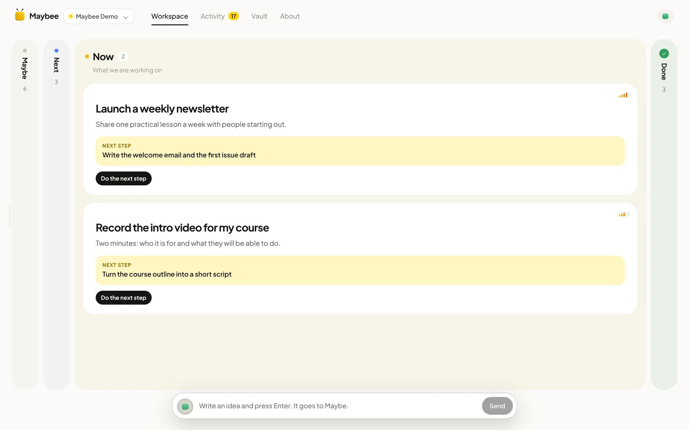
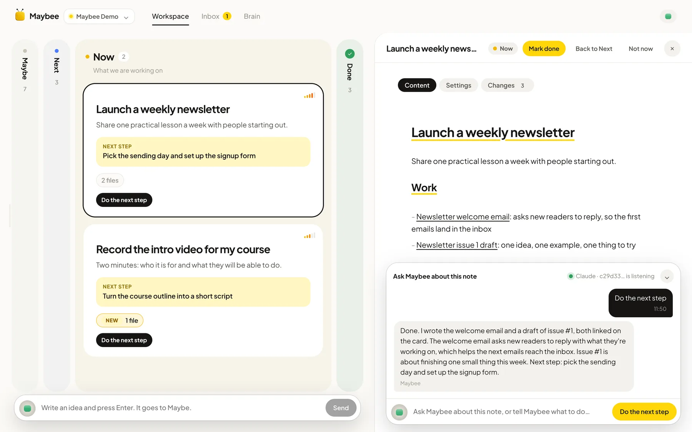
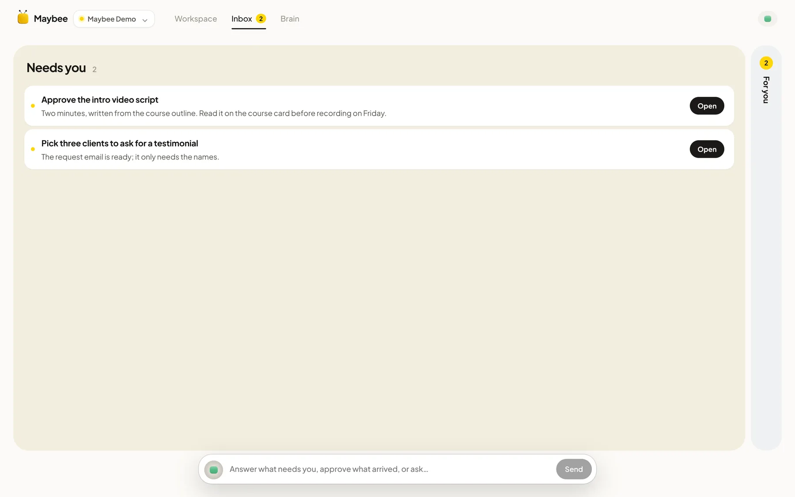
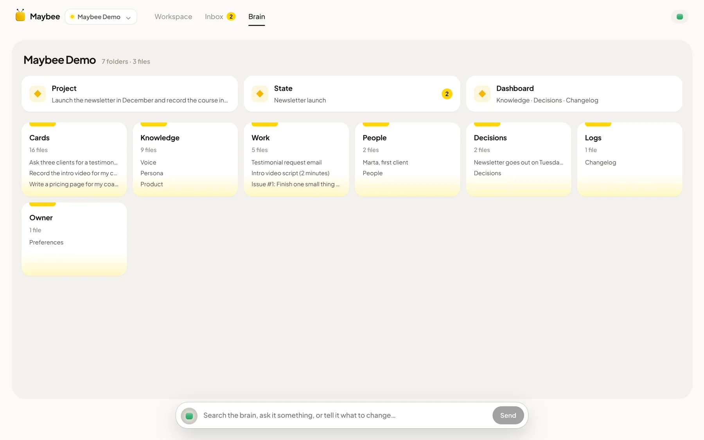

<p align="center"></p>

<h3 align="center">From maybe to done.</h3>

<p align="center">
Your ideas, from a first thought to finished work.<br>
One board for every idea, a clear next step, and an AI agent that does the work with you.
</p>

<p align="center">
<a href="https://adalbueno.github.io/maybee/"><b>Website</b></a> ·
<a href="https://github.com/adalbueno/maybee/releases/latest"><b>Latest release</b></a> ·
<a href="https://www.skool.com/how-i-9301/plans"><b>Get Maybee</b></a>
</p>

<p align="center"></p>

> [!WARNING]
> **Maybee is in early access and not fully stable yet.** New versions come out often, things can change from one release to the next, and you may run into bugs. Your ideas are safe either way: they are plain Markdown files in your folder, and updates keep a backup in `.maybee/`. If something breaks, tell us in the How I community or [open an issue](https://github.com/adalbueno/maybee/issues).

## What it is

Maybee is a local app that turns ideas into things you actually finish. Every idea is a card on one board, every card in progress has one clear next step, and the AI assistant already on your computer (Claude Code or Codex) does that step with you, with one click.

It works for any idea you want to move from "maybe" to "done": a side project, a course, content, a product, a personal goal.

## How it works

**One board, four columns.** Catch the idea, choose it, work on it, finish it.

| | |
|---|---|
| **Maybe** | Type an idea in the bar and press Enter. Nothing here is a commitment yet. Rate ideas and the best rise to the top; the ones you drop go to **Not**, with the reason. |
| **Next** | Your short list: what you will work on once there's room. Drag cards to put them in order. |
| **Now** | Only a couple of things at a time, each with one clear next step. When it's done, Maybee helps you pick the one after. |
| **Done** | Everything you finished, so on a slow week you can see how far you came. The bee celebrates. |

### The agent does the next step

Click **Do the next step** on a card. Maybee hands the card to the AI assistant running in your terminal, which does the work (a draft, research, an outline, a file), links the result on the card and sets the next step. Things you do every day or week can run on their own as **routines**.

<p align="center"></p>

### Inbox

When the agent needs your OK, it asks in **Needs you**. When it finishes something, it lands in **For you**, one line per card, like mail. Answer and approve from the chat at the bottom. You can attach a PDF, a screenshot or a spreadsheet in any chat and the agent reads it.

<p align="center"></p>

### Brain

Next to the board, Maybee keeps what your project knows: your audience, your offer, your voice, the decisions you made and the people you work with. Browse it, search it, or ask it a question and it answers from your files, with links. The agent reads it before it writes anything, so drafts sound like you.

<p align="center"></p>

## Private by design

- **Runs on your computer.** There is no Maybee cloud and no Maybee account.
- **Plain files you own.** Every idea and note is a Markdown file in your project folder, readable with or without Maybee.
- **Only your plan is checked.** The one thing Maybee looks up online is your How I plan, on Skool. When the agent works on a card, your AI assistant reads it under its own terms.

## Get Maybee

Maybee comes with **[How I Premium](https://www.skool.com/how-i-9301/plans)**, the accountability club for solopreneurs. The full install steps are inside the community. In short:

1. Have an AI assistant that runs on your computer, such as [Claude Code](https://claude.com/claude-code) or Codex.
2. Add the `maybee` skill to it from the [latest release](https://github.com/adalbueno/maybee/releases/latest) (`maybee.zip`).
3. In your project folder, tell the assistant: **"Install Maybee in this workspace."**

The assistant downloads the current release and installs everything under `.maybee/` in that folder. Nothing is installed globally, and Node.js is set up locally if you don't have it. On first start you sign in to Skool once, and Maybee opens in its own window.

To update later, tell the assistant `/maybee update`. Your ideas and notes are never replaced by an update.

**Requirements:** Linux or macOS (x64 or ARM), an installed Chromium-based browser (Chrome, Edge, Brave or Chromium), and Claude Code or Codex.

## For developers

```
app/        the local app: Node server, web interface and agent scripts
skill/      bootstrap/ is the small skill people install; maybee/ ships inside the package
release/    what goes into the package: manifest, start scripts, default workspace, migrations, what's new
playbooks/  importable playbooks, published as separate playbook-<name>.zip files
scripts/    build and test scripts
docs/       the website, published by GitHub Pages
```

**Run the tests**

```bash
for t in scripts/test-*.mjs; do node "$t"; done
```

**Build a release locally**

```bash
scripts/build-release.sh
```

This writes to `dist/`: `maybee-package-<version>.zip` (the app), `maybee-<version>.zip` (the bootstrap skill), stable `maybee-package.zip` and `maybee.zip` aliases, and one `playbook-<name>.zip` per playbook. `node_modules`, app data and user files are left out.

**Publish a release**

Bump `version` in `release/manifest.json`, commit, then push a matching tag:

```bash
git tag v0.1.51 && git push origin v0.1.51
```

GitHub Actions checks that the tag matches the manifest, builds the archives and publishes the release. Because the stable aliases are attached to every release, `/releases/latest/download/maybee-package.zip` always points to the newest one.

---

<p align="center">Made by <a href="https://github.com/adalbueno">Adal Bueno</a> · Maybee comes with <a href="https://www.skool.com/how-i-9301/about">How I Premium</a></p>
